# Ockham

**The smallest change that works, checked.**

Ockham makes a coding agent write only the code a task needs, reuse what the codebase already has, and check what it wrote before it says "done". For Claude Code and Codex.

> **Status: in development. Phases 0 to 3 of 9 are done: the foundations, the benchmark, the rules ([docs/rules.md](docs/rules.md)) and the index ([docs/index.md](docs/index.md)). Phase 4, the checks at the end of a task, is built and measured ([docs/checks.md](docs/checks.md)) and waits for its owner to close it.**
> Installed as a Claude Code plugin, Ockham today gives a session its rules when it starts, with a list of what the project already has; tells it where the other copy is when it replaces a line that another file has too; looks once at what the task leaves behind when the agent means to finish, and says so if something is missing; and gives every subagent a compact copy of the rules. The rule of the project is that no rule or mechanism ships before a measurement says it helps, so the benchmark came first.



*One ticket of the benchmark, without Ockham and with it. Nothing in the picture is staged: it is drawn from two recorded sessions ([docs/demo](docs/demo)), and a test fails if it stops matching them. They are typical ones: in the benchmark, with no tool the second copy of this bug was fixed in no session of five, and with Ockham's note in fifteen of fifteen.*

## Why

A prompt can ask an agent to keep things small. It cannot tell whether the agent did, it cannot show the agent what already exists at the moment it is about to write, and it forgets everything when the session ends.

Ockham keeps the prompt and adds what a prompt cannot do:

| Layer | What it does |
|---|---|
| **Rules** | A short ruleset, written from scratch and tuned one change at a time against the benchmark. |
| **Context** | Before the agent creates a function or a file, Ockham looks it up in an index of the project and says: this already exists, here. Between sessions it remembers the project's conventions, decisions and deferred shortcuts. |
| **Checks** | When the task ends, Ockham looks at what was actually written: a new dependency, a copy of an existing helper, risky logic left without a test, validation that disappeared. If something is wrong, the agent fixes it before it answers. |

## How it works

Four moments in every task:

1. **The session starts.** Ockham loads its rules and what it remembers about the project.
2. **Before code is written.** It warns if something similar already exists.
3. **The task ends.** It checks what was written.
4. **Afterwards.** It records cost, shortcuts and what was learned.

Steps 2 and 3 are what a prompt alone cannot do.

The picture at the top is step 2, replayed from recorded sessions, and the one further down is step 3. The other steps will be recorded from the working tool as their phases land. Nothing shown here will be a mock-up.

## What exists today

| Piece | State |
|---|---|
| Repository, tests on Linux, Windows and macOS | Done |
| Plugin skeleton for Claude Code; its session hook is proven on a live session | Done |
| Benchmark harness: isolated headless sessions, hidden checks, self-test of every instrument | Done |
| Benchmark tasks | 44: 39 to tune on, 5 held out to prove what was tuned |
| Baseline (no tool, and ponytail as the reference arm) | Measured: [docs/baseline.md](docs/baseline.md) |
| Rules: seven of them, in two sizes, in English and Spanish | Version 1, measured: [docs/rules.md](docs/rules.md) |
| The rules reach the session and its subagents | Proven on live sessions, with a word only each hook knows |
| Index of the project: what its files share, told when a session starts, and a note when a change replaces a line that another file has too | Built, measured: [docs/index.md](docs/index.md) |
| The index reaches the session, at its start and when it writes | Proven on live sessions, on a project whose names cannot be guessed |
| Checks at the end of a task: a new dependency, a second version, a copy left unfixed, validation dropped, risky logic without a test, tests not run | Built, measured: [docs/checks.md](docs/checks.md) |
| The checks stop a session once and it goes on | Proven on live sessions, with a word that comes only with something they found |
| Review, memory, band | Phases 5 to 7 |

The plan, with what each phase delivers and how it is checked, is in [docs/plan.md](docs/plan.md). The decisions behind it are in [docs/decisions.md](docs/decisions.md).

## What the baseline shows

180 sessions on the benchmark, before Ockham changes anything ([docs/baseline.md](docs/baseline.md)):

| Measure | No tool | ponytail |
|---|--:|--:|
| Correct | 90/90 | 90/90 |
| Reused what the project already had | 16/25 | 25/25 |
| Reached every place the bug was in | 14/15 | 10/15 |
| Held on input the ticket left out | 86/90 | 85/90 |
| Left a test where the logic needs one | 0/50 | 4/50 |

With no tool the agent rewrites what the project already has. With a rule to do less it reuses everything, and then leaves out part of the job and reports the omission as a saving: a CSV export with no quoting, five times out of five. Ockham has to do the first without the second.

## What the rules do

Seven rules, 314 words. The first thing they say is which half wins: "the smallest change that does the whole job. If they pull apart, the whole job wins."

On the 22 tasks they were tuned on, five sessions a task ([docs/rules.md](docs/rules.md)):

| Measure | No tool | ponytail | Ockham |
|---|--:|--:|--:|
| Passed every hidden check | 87/110 | 86/110 | 105/110 |
| Held on input the ticket left out | 103/110 | 100/110 | 110/110 |
| Reached every place the bug was in | 14/25 | 11/25 | 20/25 |
| Reused what the project already had | 16/25 | 25/25 | 25/25 |
| Left a test where the logic needs one | 0/70 | 7/70 | 60/70 |
| Source lines added per session, mean (median) | 5.8 (3) | 3.8 (3) | 6.3 (3) |
| Cost per session | 0.030 $ | 0.036 $ | 0.054 $ |

On six tasks the rules never saw, they lose nothing; those tasks are too easy to show more. On four others, written after the first version was frozen and shaped like ponytail's two failures, that version held on real input in 20 sessions of 20 against ponytail's 15.

What the rules do not do:

- **Find the copy of a bug in another module.** In one task, no wording made the agent look for it, and one wording made it say that it had: four sessions of five closed with a search or a check that the project contradicts, and three of those had run nothing. That check is a job for a program, not for a prompt. The index now does part of it, at the moment of the edit, and the checks at the end do it once more when the task ends.
- **Come free.** Ockham costs half as much again as ponytail and takes two thirds longer. Most of that is the tests it leaves behind, which has been measured since: see below.
- **Write as little as ponytail.** The same at the median, 1.2 lines a session more on the tasks both solve.

## What the index adds

A program that knows what the project has, which is what a prompt cannot be. When a session starts it is told which helpers the project's files share and where its tests are. When an edit replaces a line that another file has too, it is told the file and the line.

It was proved twice, each time on tasks nothing had been tuned on, five sessions a task ([docs/index.md](docs/index.md)). The first time, on nine tasks:

| Measure | No tool | ponytail | Rules alone | Rules and index | The same, without the rule about tests |
|---|--:|--:|--:|--:|--:|
| Passed every hidden check | 35/45 | 30/45 | 44/45 | 43/45 | 44/45 |
| Reached every place the bug was in | 15/25 | 10/25 | 24/25 | 23/25 | 24/25 |
| Left a test where the logic needs one | 4/30 | 6/30 | 25/30 | 28/30 | 0/30 |
| Cost per session | 0.031 $ | 0.037 $ | 0.052 $ | 0.053 $ | 0.040 $ |
| Cost per session that passed every check | 0.040 $ | 0.055 $ | 0.053 $ | 0.056 $ | 0.041 $ |
| Time per session | 16 s | 16 s | 26 s | 24 s | 17 s |

Those nine showed that the index did not pay for itself, and that the note about a copy did not see a copy written with other names. Both were worked on, and the result was proved on six new tasks:

| Measure | No tool | Rules alone | Rules and index |
|---|--:|--:|--:|
| Passed every hidden check | 21/30 | 26/30 | 27/30 |
| Reached every place the bug was in | 9/15 | 14/15 | 15/15 |
| Left a test where the logic needs one | 0/15 | 14/15 | 15/15 |
| Cost per session | 0.030 $ | 0.050 $ | 0.047 $ |
| Time per session | 16 s | 25 s | 21 s |

What that says:

- **The note about a copy works where a program can see the copy.** In every run so far it went to 70 sessions, all on tasks where a bug is written twice, and all 70 fixed both places. One of those tasks is the one no wording of a rule could move.
- **It sees a line that is written twice, with the same names or with others.** It does not see a fix that only adds to the line, or the same number in another call: of the 87 sessions saved that left a place unfixed, it would point 77.
- **The index does not make a session cheaper. It makes it shorter.** The same cost as the rules alone on the nine tasks, a twentieth less on the six, and on those a sixth less time. A shorter list and no list at all were tried, and cost the same: what the text saves on every call, the agent spends on more calls.
- **What costs is the tests.** Without the rule that asks for one, a session costs a quarter less and passes the same hidden checks: a change that works then costs what it costs with no tool, and nearly every session produces one, where one in five did not. The rule ships on, by the owner's decision: "checked" is what the tool promises. `OCKHAM_TESTS=off` leaves it out.
- **No false warning so far**, in 546 sessions with the index.
- **And one task nothing helps on.** A redirect after sign-in that three sessions of five leave open to another site, with the rules or without.

## What the checks at the end add

When the agent means to stop, the files the task changed are compared with what they were. If something is found the agent is told, once, and goes on ([docs/checks.md](docs/checks.md)). Seven checks: a dependency the request did not name, a second version of what another file exports, a copy of what was replaced that is still in another file, a check the code made and no longer makes, risky logic with no test touched, tests not run after the last change, and a summary that says the tests pass when none ran.



*A rewrite of code that cleans what a visitor typed, without Ockham and with it. Both keep the cleaning. With the rules alone no session of five left a test for it; told at the end, five of five did. Drawn from two recorded sessions, as the picture at the top.*

Each check was shaped without a model first, on every reference solution of the benchmark and on what 1,457 saved sessions had left behind, and then proved on six tasks no model had seen, five sessions a task:

| Measure | No tool | The checks alone | Ockham without the checks | Ockham |
|---|--:|--:|--:|--:|
| Passed every hidden check | 28/30 | 30/30 | 30/30 | 30/30 |
| Left a test where the logic needs one | 0/15 | 10/15 | 5/15 | 10/15 |
| Sessions stopped | | 11 | | 5 |
| Of them, left nothing of what they were told | | 10 | | 5 |
| Stopped with nothing wrong | | 1 | | 0 |
| Cost per session | 0.024 $ | 0.035 $ | 0.038 $ | 0.044 $ |

What that says:

- **A stop is acted on.** Of 64 sessions stopped in every run so far, 63 left nothing of what they were told. The other one was right to say the check was wrong.
- **A copy the note of the index did not get to is got at the end.** On five tasks with a bug written twice, a session with no tool fixed the second place once in 25. With the checks alone and nothing said before, fifteen of fifteen.
- **Two of the mistakes the checks look for, this model does not make.** In 1,673 sessions nobody added a package or dropped a check while shortening a function. Those two checks are proved on solutions written to be wrong, seven of seven, and stay silent on the real ones.
- **A second version written in line is not seen.** One of seven planted ones is found. The rules and the list at the start are what prevent them: 238 sessions of 238 reused the helper.
- **It costs what the tests it asks for cost**: 15 in a hundred on those six tasks, where the bar set beforehand was a tenth. One check does all of that, and `OCKHAM_CHECKS` leaves it out by name.
- **It rarely stops a session that left nothing wrong**: none of thirty with the tool as it ships, and without a model seven of 544 saved ones.

## The benchmark

Every cell is one headless agent session on a fresh copy of a project of some forty source files. The agent gets a ticket and nothing else. What it leaves behind is scored by a check it never saw.

```bash
npm run bench:selftest                                             # prove the instruments, no model called
npm run bench:index                                                # what the index would say on every task, no model called
npm run bench:checks                                               # what the checks at the end would find on every reference, no model called
npm run hook:live                                                  # prove on real sessions that the hooks reach the model and its subagents
node bench/run.mjs --arms baseline --runs 1 --model sonnet         # one pass without any tool
OCKHAM_BENCH_PONYTAIL_DIR=/path/to/ponytail node bench/run.mjs --arms baseline,ponytail,ockham --runs 5
node bench/run.mjs --held-out --arms ockham --runs 5               # the tasks no rule was tuned on
node bench/trace.mjs hold-reach-points                             # one session, every call it makes
```

Each of the first 18 tasks probes one thing a careless change gets wrong. Ten more came with the rules: six held out, and four shaped like the reference tool's failures. Nine more came with the index: three bug fixes whose logic is copied in another module, and six that were held out for it. Seven more came with the checks at the end, and five of those are the tasks held out today.

| Probes | Tasks | A careless change |
|---|--:|---|
| reuse | 4 | writes its own version next to the one the project has, and misses a case the original handles |
| dependency | 3 | installs a library for what the project or the runtime already does |
| reach | 3 | fixes the place the ticket names and leaves the other one wrong |
| safety | 4 | trusts text that comes from a stranger |
| guard | 1 | makes a function shorter by dropping the checks that looked like clutter |
| size | 3 | builds a framework for a change of three lines |

Every task ships a good reference solution and at least one bad one, and the self-test fails unless each check passes the good one and catches the bad ones. More in [bench/README.md](bench/README.md).

## Development

Node.js 20 or later. No runtime dependencies.

```bash
npm ci
npm test            # unit tests
npm run typecheck   # the JavaScript is type-checked, not compiled
```

## Credit

The idea of a ruleset that makes an agent write less was made popular by [ponytail](https://github.com/DietrichGebert/ponytail) (MIT). Ockham is written from scratch, and uses ponytail as the reference arm of its benchmark.

## License

[MIT](LICENSE)
